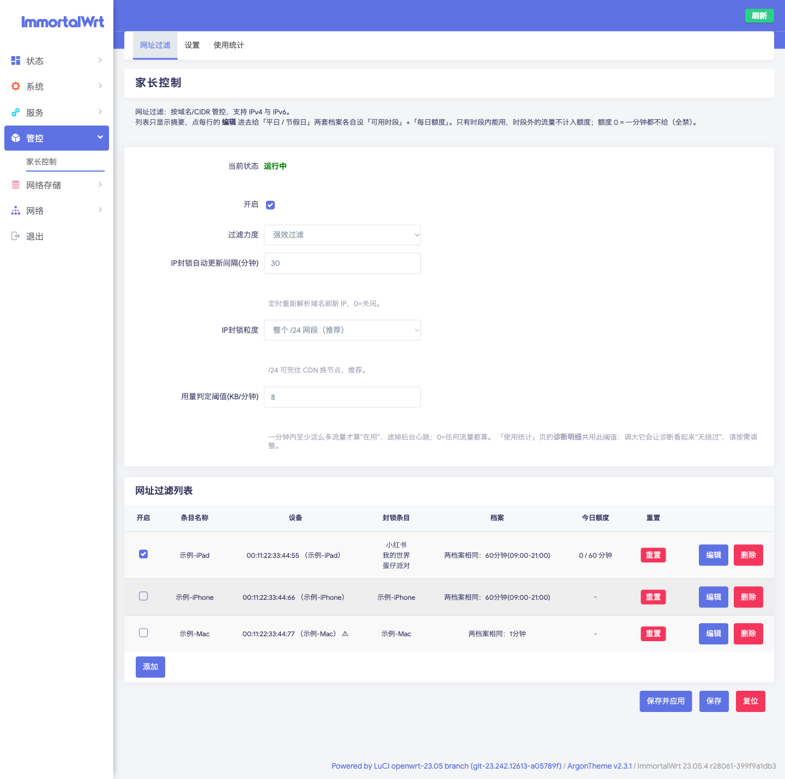
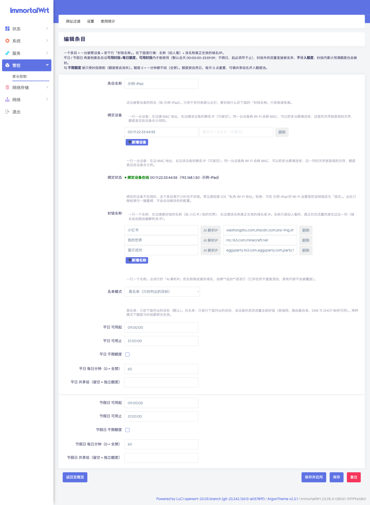
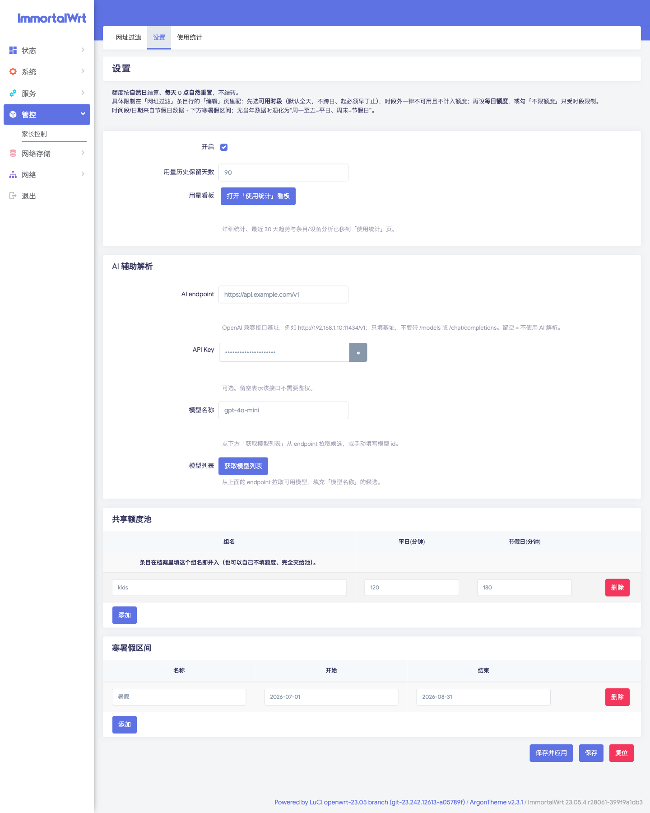
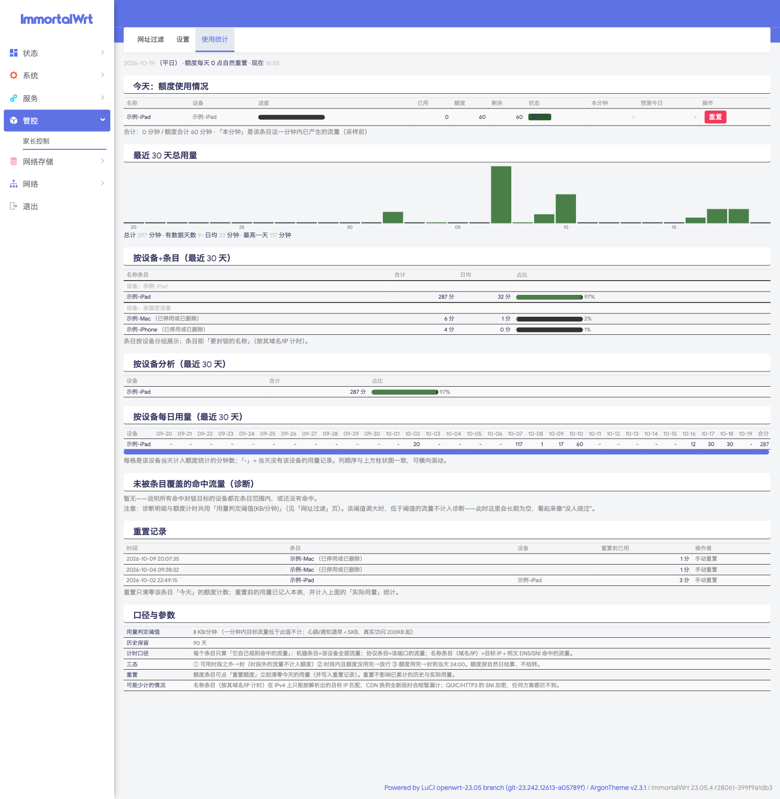

<h1 align="center">
   luci-app-parentcontrol 
</h1>

家长控制：按网址/域名过滤某台设备，并支持**可用时段 + 每日累计使用额度**。
（界面上的「时间限制」「协议过滤」两页已移除：「时间限制」的模型与「可用时段」意义重叠；
「协议过滤」（按端口/协议封禁）在「按域名/网址过滤」模型里没有被用到，故一并不再提供界面。
⚠ 注意：**shell 侧仍然支持这两类条目**，存量配置里若还有**启用中的** time/protocol 条目，它们会被照旧执行、
但界面上没有入口可改 —— 要彻底停用请把它们关掉或删掉对应的 uci 节。）

**在开启软件加速的 IPv4/IPv6 双栈环境下，「网址过滤」按 MAC 拦某个网站会完全失效**
（而且是静默失效：界面正常、iptables 不报错）。本插件已解决这个问题，并在此之上提供：

- **每日累计使用额度**（用完即封、自然日结算、不结转）
- **平日 / 节假日双档案**（每份档案独立设「可用时段 + 每日额度」；额度填 0 = 全天禁止）
- **共享额度池**（多个条目共用一个额度）
- **法定节假日自动识别 + 寒暑假手动区间**
- **按 IP/CIDR 封锁 + 域名解析自动更新**（IPv4 只能这么封，见下）
- **IPv4 / IPv6 同等对待**：封锁链两族都带「到局域网放行」守卫，封锁时段设备仍能访问家里的设备与路由器
- **一条目多设备（1.8.7）**：条目里的「绑定设备」是一张**行表**，一行一台设备（MAC + 可选静态 IP）—— iPad 换了 Wi-Fi 就再加一行；同一行的 MAC 与该行自己的 IP 任一命中即生效。同一条目的多台设备**共用这一条的额度与时段**（换 MAC 不掉额度）
- **防改 MAC**（静态 IP/主机名，与 MAC 任一命中即生效）
- **黑白名单**：一条目一个开关 —— 黑名单=只封列出的目标；白名单=只放行列出的目标、其余全封（额度/时段照旧生效）
- **绑定健康**：绑定设备的 MAC 不在网时列表页给 ⚠、编辑页给一键重绑（应对 iOS「私有 Wi-Fi 地址」轮换）
- **诊断明细**：统计「命中了封锁目标、但不在该条目设备范围内」的客户端流量，用来发现绕过
- **列表瘦身 + 详情独立编辑页**，列表显示「设备名 + 今日额度」

## 安装

从 [Releases](https://github.com/neohob/luci-app-parentcontrol/releases) 下载最新版本：

| 文件 | 怎么用 |
| --- | --- |
| `luci-app-parentcontrol_<版本>_all.ipk` | `opkg install <文件>`，或在 LuCI「系统 → 软件包 → 上传软件包」里上传 |
| `luci-app-parentcontrol_<版本>.run` | 不依赖 opkg 的自解压安装器：`sh <文件>` 安装，`sh <文件> uninstall` 卸载 |

包内全是 Lua / shell / 配置文件，不含编译产物，`Architecture: all` ——
**一个包适用于所有 CPU 架构**（x86_64 / arm / mips / aarch64 …），不需要按架构分别下载。

装完在 LuCI 里进 **网络 → 家长控制**。依赖 `iptables-mod-filter` 与 `kmod-ipt-filter`
（用 `.ipk` 安装时 opkg 会一并装上；用 `.run` 安装请先确认这两个已就绪）。

## 界面

<table>
<tr>
<td align="center" width="50%"> <b>网址过滤</b>：条目列表（设备 / 封锁名称 / 档案 / 今日额度）+ 过滤力度、IP 刷新间隔、封锁粒度、用量阈值</td>
<td align="center" width="50%"> <b>编辑条目</b>：条目名称 + <b>绑定设备行表</b>（MAC / 静态 IP，多台共用一条额度）+ <b>封锁名称行表</b>（行内「AI 解析IP」）+ 名单模式 + 平日/节假日两套档案</td>
</tr>
<tr>
<td align="center" width="50%"> <b>设置</b>：全局开关 + 历史保留 + 用量看板入口 + 共享额度池 + 寒暑假区间 + AI 辅助解析</td>
<td align="center" width="50%"> <b>使用统计</b>：今天进度、最近 30 天趋势、按条目/设备分析、<b>每设备每日用量矩阵</b>、诊断明细、重置记录</td>
</tr>
</table>

> 截图中的 **MAC 地址、静态 IP 与设备名均已替换为示例值**，不是真实数据；
> 「共享额度池」与「寒暑假区间」里的演示行（`kids` / `暑假`）也是为截图临时填的示例，不代表任何真实配置。
> 列表**只显示摘要**：`设备（含设备名） / 档案（平日+节假日一句话） / 今日额度`，
> 点每行的 **编辑** 进独立页做详细设置。

## 主要改动

### 1. 修复四处缺陷

1. `local Z1,Z2,...,Z7=0,...` 是 bash 语法，ash(busybox) 会报 `bad variable name` 并**中止整个脚本**，
   导致 time 之后 protocol/weburl 两组规则根本没被设置，还留下一个锁文件。
2. `del_rule` 里的 `$i -F $TAG` / `$TAGP` / `$TAGW` 是 `$ip` 的笔误，旧规则不会被清掉，规则不断堆叠。
3. `start()` 缺少陈旧锁判断：脚本一旦被中断，锁文件残留，此后每次 `start()` 都 exit 1，
   界面显示未运行却不报错。
4. `/etc/hotplug.d/iface/97-parentcontrol` 里 `[ "$(`uci -q get ...`)" == 1 ]` 把 `$( )` 和反引号套在一起，
   外层会把内层命令的**输出**当成命令执行（报 `1: not found`），条件恒为假 —— 脚本永远 exit 0，
   接口事件后从不重装规则。

### 2. 挂载点改到 mangle PREROUTING

早期版本挂在 `OUTPUT` 链，而 `-m mac --mac-source` 在 OUTPUT 里**永远不成立**
（路由器本机发出的报文没有源 MAC），所以「按 MAC 限制某台设备访问某网址」从来就没生效过。

改挂 mangle 表的 PREROUTING —— 只有这个位置同时能看到客户端源 MAC 和明文负载，
并且位于 flowtable 快转决策和其它组件 DNAT 之前。

### 3. 有受管设备时停用 flow offloading

fw4 会往 `forward` 链装一条 `meta l4proto { tcp, udp } flow add @ft`，把已建立的连接丢进
流卸载表；之后这条连接的报文在内核 ingress 快路径直接转发，**整个 netfilter 栈（含
mangle PREROUTING）都不再经过**，挂在 PREROUTING 上的规则自然也就失效了。

一开始想只把受管设备排除出去，写成 `ether saddr != <MAC> flow add @ft`，但**这个条件盖不住入方向**：
出方向源 MAC 是客户端，能排除；入方向（回包）的源 MAC 是上游网关、目的 MAC 此时还是路由器
自己的（LAN 侧的以太头是在 forward 钩子之后才写的）—— 于是**回包一进来就把整条流加进卸载表，
之后双向都绕过 netfilter**。

而且流一旦被卸载，**不会因为后来把规则拿掉就退出**（`nft delete flowtable` 报 `Resource busy`），
会一直漏到自然过期。表现出来就是「关掉列表再打开，封不住；设备息屏重连之后又好了」。

本插件的做法：**只要列表里还有受管设备（不管有没有勾选），就整条拿掉那条 `flow add` 规则**；
并用 `conntrack` 显式清掉受管设备现有连接，让它们重新握手、被 IP 封锁拦住。停用插件时自动恢复。

代价：只要列表里有受管设备，**全部设备的流卸载都是关闭的**（多走一遍 netfilter，x86 上通常无感）。
需要 `conntrack` 工具（`opkg install conntrack`）才能立即清掉旧连接。

### 4. 按 IP/CIDR 封锁 + 域名解析自动更新

**为什么必须有它：** 在那类设备上，**IPv4 转发报文的负载落在 skb 的 page frags 里，`-m string`
看不到它**。实测：一个带唯一标记的明文 HTTP GET，转发路径上数到 18 个包经过 `mangle PREROUTING`，
标记匹配 **0** 个（关掉 GRO 也一样）。所以「按关键词匹配 TLS SNI」对 **IPv4 转发流量完全无效**。
（IPv6 相反 —— 走隧道、解封装会把负载线性化，SNI 能匹配。）

**本插件的「网址封锁」在 IPv4 上实际是 IP 封，不是域名封。** 域名在这里的唯一作用是
「被解析成 IP，再按 `-d <ip>` 封」。字面串规则（`-m string` 匹配明文 DNS 53 / TLS SNI 80,443）
在 IPv4 上**双重失效**：① 转发报文的负载落在 skb 的 page frags 里，`-m string` 看不到（实测 0/18）；
② 即便看得到，DNS QNAME 是 wire format（`\x03www\x0bexample\x03com\x00`），
带点的域名串并不是它的子串。所以「填了域名」并不等于「按域名封」——真正拦住的是解析出来的 IP。
对自带 HTTPDNS/QUIC 的客户端覆盖不到其真实 IP，这是**机制上限，不是配置问题**。

**结论：IPv4 转发流量只能按目标 IP（报文头）来封。** 于是：

- 按解析出的目标 IP 封锁（规则进 `PARENTCONTROL_QUOTA` 链，mangle PREROUTING —— 已把旧的独立 `PARENTCONTROL_IP` / `PARENTCONTROL_WEBURL` 链统一掉）
- 网址行的「域名/IP」列写域名即可：会被解析成 IP 一起封（apex 天然覆盖子域）；
  字面串规则仍会生成，但在 IPv4 上不生效（见上）
- IPv4 默认封整个 `/24`（`basic.ip_mask` 可改 `32` 只封精确 IP）；IPv6 封 `/64`
- 解析同时取 apex 与 `www.` 两个变体（A 常在 apex、AAAA 常在 www）
- 列里**含 `/` 的项直接当 CIDR 封**，不解析（应急口子）
- 解析结果**按条目**累积在 `/etc/parentcontrol/ips/weburl_<N>`，只增不减 —— CDN 换节点后老节点
  仍被挡住
- cron 按 `basic.ip_refresh`（默认 30 分钟，`0`=关闭）调用 `refresh_ip` 刷新；crontab 条目由插件自己维护

### 5. 状态判定

- 「开启」开关勾着就显示运行中（列表全空只意味着没有规则去匹配，不等于没运行）
- 状态接口同时查 `mangle` 与 `filter` 两个表，只判断链是否存在

### 6. 每日额度（核心功能）

**计时口径：每个条目只算「它自己规则命中的流量」**
- 机器（时间）条目 = 该设备（MAC 或静态 IP）的**全部**流量
- 协议条目 = 该设备在**这组端口/协议**上的流量
- 网址条目 = 该设备发往**该条目目标**的流量：目标 IP **加上**明文 DNS(53) / TLS SNI(80,443) 命中的包

实现：额度条目在 mangle 建常开计数链 `PARENTCONTROL_ACCT`，命中即跳进空链 `PCA_<条目>`，
读跳转规则的字节计数；目标规则与「封锁规则」共用同一个生成器，保证两侧枚举的目标集合永不漂移。

**三态（按自然日、不结转）**
| 状态 | 时间 | 效果 |
|------|------|------|
| ① 时段外 | 00:00 – 24:00 中**不在**可用时段内的时刻 | 封（且这部分流量不计入额度） |
| ② 时段内 + 未用完 | 可用时段内且额度没用完 | 放行 |
| ③ 耗尽 | 额度用完（不论在不在时段内） | 封（立即切断） |

**全禁 = 额度填 0**：判定恒为 `封 = 不在时段内 或 已用 ≥ 额度`，N=0 时第二项恒成立，
不需要额外的开关。想永久禁掉某个 App/设备就用它。

- **可用时段**：每个档案自己一对（`sd_qstart`/`sd_qend`、`hd_qstart`/`hd_qend`），秒级 `HH:MM:SS`，
  默认 `00:00:00-23:59:59`（全天）；**不跨日**、起必须早于止
- **额度每天 0 点自然重置**（用量文件本来就按 `YYYYMMDD` 分文件），「发放时刻」这个设置已移除
- 勾 **不限额度**（`_unlimited=1`）→ 只受时段限制，额度框在界面上会隐藏
- 计时：cron 每分钟采样一次字节增量，**有流量且增量 ≥ `usage_min_kb`（默认 8 KB）**才记 1 分钟；
  同一分钟内多次流量只记 1 分钟
- 共享额度池：条目在档案里填同一个组名即并入（也可以自己不再填额度、完全交给池），组内流量加总、共用额度，组耗尽则所有成员一起封

### 7. 防自锁（重要）

额度耗尽的封锁规则在 mangle PREROUTING，**这个位置对「发往路由器自身」的流量同样生效** ——
一条「没填 MAC（= 全部客户端）」的额度条目一旦耗尽，会生成无条件 DROP，**把 SSH/LuCI 一起切断**，
只能上控制台救。为此做了两层保护：

1. `PARENTCONTROL_QUOTA` 链的**最前面**永远插入「到局域网网段 → RETURN」的放行规则
   （网段含路由器自身 IP，所以管理面不会被自己的封锁断掉）。实测本机没有 `addrtype` 模块，
   只能用目标网段放行。**两个族都有这条守卫**：IPv4 的网段取自 UCI 里的静态接口；
   IPv6 的网段取自**内核路由表的直连路由**（GUA/ULA 都不在 UCI 里），只收直连、排除转发/默认/不可达。
   （IPv6 侧这条守卫自 1.8.2 起补齐；1.8.1 及以前 IPv6 链上没有守卫。）
2. 拿不到局域网网段时，**对「没填 MAC」的条目不封锁**（只记日志），宁可少封也不错封。
3. `start()` 用 `trap` 保证中途失败也会清掉锁文件。

### 8. 界面

- 列表只显示摘要：`开启 / 条目名称 / 设备 / 封锁条目 / 档案 / 今日额度 / 重置`，
  每行一个 **编辑** 按钮（1.8.7 起「静态IP」列并入「设备」列：设备列一行一台设备）
  - **设备**列每台设备一行 `MAC（设备名）`，同一行的静态 IP 跟在 MAC 后面；多台用 ` / ` 连接。
    设备名取自 DHCP 租约/ARP（`luci.sys.net.mac_hints`）
  - **档案**列显示紧凑摘要：两档案一致时只写一次（`两档案相同：60分钟(09:00-21:00)`），
    否则 `平日 … · 节假日 …`；全天时段不写、秒不写
  - **今日额度**列显示 `12 / 30 分钟`；勾了「不限额度」显示 `不限`；条目不存在时显示 `-`
- 点 **编辑** 进独立页（`weburl_edit`），容纳全部详细字段
- 「**设置**」页（原「使用限额」）：共享额度池、寒暑假区间，以及「AI 辅助解析」（endpoint/model/apikey + 获取模型列表）
- 编辑页：**条目名称** → **绑定设备行表**（一行一台设备：MAC + 该设备的静态 IP，可增删；下方带「绑定状态」）→ **封锁名称行表**（每行一个名称 + 其域名/IP，行内「AI 解析IP」）→ **黑/白名单** → 平日/节假日档案（详见第 10 节）
- 插件内所有文案都是**中文字面量**（不受 LuCI 界面语言影响）

### 9. AI 辅助解析域名

「封锁名称行表」的**每一行**右边都有一个 **「AI 解析IP」** 按钮：

1. 在该行的 **名称** 里填应用/游戏/网站名（中英文均可），也可以直接填域名/IP/CIDR；
2. 点 **AI 解析IP**：形如域名/IP/CIDR 的项**直接**填进该行的**域名/IP**栏；
   其余名称由路由器**服务端**请求你配置的 OpenAI 兼容接口，换成**真实 ASCII 域名**后**追加**进去
   （已存在的不重复添加，原内容不覆盖，且只影响这一行）；
3. 确认后点 **保存并应用**。之后由既有的 cron 刷新链路（`basic.ip_refresh`，默认 30 分钟）把域名解析成
   IP 并重建规则；解析结果按条目累积在 `/etc/parentcontrol/ips/weburl_<N>`，**只增不减**。

要点：

- **AI 只管「名称 → 域名」**，不碰 IP、不改时段/额度。真正拦住流量的仍是「按域名解析出的 IP 封锁」。
- 接口是**服务端**发的（路由器自己请求），浏览器不直连、API Key 不出内网；
  请求/响应走 `/tmp` 临时文件，不拼 shell 字符串。
- 「**设置**」页有「AI 辅助解析」区块：填 `endpoint` / `model` / `apikey`，
  点 **获取模型列表** 可以从 `{endpoint}/models` 拉候选
  （**endpoint 只填基址**，不要带 `/models` 或 `/chat/completions`，否则会拼出重复路径）。
- **失败不会自动回退**：未配置 endpoint/model、路由器缺 HTTP 客户端（`curl`/`uclient-fetch`/`wget` 全无）、
  请求超时或非 2xx、返回不是 JSON、过滤后没有合法域名（会提示「AI 没有解析出合法域名，
  请手动填写域名或 IP」）—— 都会在按钮旁显示**明确原因**，
  且**不改动**「域名/IP」里的内容，你可以手动填域名或 IP。
- 需要运行时能上网；`curl`/`uclient-fetch`/`wget` 任一即可（访问 https 还需 `libustream-ssl` + `ca-bundle`）。
  这些**不是插件的硬依赖**，不进 `LUCI_DEPENDS`。
- AI 产出的必须是**真实 ASCII 域名**（带点、可被 DNS 解析）；中文、解释性文字、markdown 代码块、
  列表编号都会被丢掉。

### 10. 封锁名称行表、黑白名单、绑定健康与诊断明细

**一个条目 = 若干台设备 + 若干行「封锁名称」。** 编辑页按下面的顺序填：条目名称 → 绑定设备行表 →
封锁名称行表 → 黑/白名单 → 平日/节假日档案。绑定设备行表每行一台设备（MAC + 该设备可选的静态 IP），
封锁名称行表每行两栏：左边是名称（给人看的，如「小红书」），
右边是该名称真正生效的域名/IP（点该行的「AI 解析IP」由 AI 补齐，结果**追加**、不覆盖）。
列表页对应两列：「条目名称」（`remarks`，空则兜底首个封锁名称）与「封锁条目」（一行一个名称）。

#### 10.1 黑白名单（`mode`）

- **黑名单（默认）**：只封你列出的目标。行为与历史版本完全一致。
- **白名单**：该设备**只放行**你列出的目标，其余流量一律封锁；局域网、路由器自身、DNS(53) 与 DHCP(67/68) 始终可用。
  **额度与时段照旧生效**：允许时段内只放行列出的目标；一旦额度用尽或到了时段外，这台设备**整体全封**
  （连列出的目标也不可达）——即白名单不会成为绕过额度的口子。
- 想临时恢复：把条目「开启」关掉即可立刻放行。

#### 10.2 设备绑定为什么会失效（重要）

条目是按 **MAC（或静态 IP）** 认设备的。而 **iOS / iPadOS 的「私有 Wi-Fi 地址」默认会轮换**
（iPadOS 18 起约两周换一次）：设备换了 MAC 之后，旧条目**既不计时也不封锁**——
2026-10-11「小红书没防住」就是这个原因（网内在用的是另一台 iPad，而没有任何条目覆盖它）。

排查与恢复：

1. 打开「网址过滤」列表：**页顶**会出现一行提示，**设备**列该行带 ⚠ —— 说明条目绑的 MAC 不在网；
2. 点该行「编辑」：MAC 框下方会显示红字警告 + **当前在网设备列表**（MAC / IP / 主机名）；
3. 点对应设备的「**用这个 MAC**」，再点页面底部「保存并应用」，规则立刻切到新 MAC。

根治办法（设备侧）：在 iPad 的「设置 → 无线局域网 → 该网络 ⓘ → 私有 Wi-Fi 地址」里选择
「**固定**」（关闭轮换），这样 MAC 不再变，条目长期有效。真正的防篡改在设备端
（屏幕使用时间 / MDM），路由器侧只能检测与报警。

**本轮明确不做**：未知 MAC / 未批准设备**默认断网**、按照 MAC 变更**自动**改你的配置、
把 hostname 当匹配依据（只用于展示）。这些要么会误伤访客、要么属于越权自动化。

#### 10.3 诊断明细：谁在绕过？

统计页新增区块「**未被条目覆盖的命中流量（诊断）**」：对每个启用的网址条目，统计
「**命中了该条目的目标、但不在该条目的设备范围内**」的客户端流量（即：不是它管的设备，
却在访问它管的目标）。每行给出 MAC / IP / 主机名 / 条目 / 今日命中分钟 / 首次与最近命中 /
最近 30 天按天合计 / 命中过的目标。空态会说明「所有命中目标都在条目范围内，或还没有命中」。

怎么读：

- 出现某台设备的行 = 这台设备**没有被任何条目覆盖**却在访问被封锁的目标 —— 就是「绕过」。
  常见原因就是 10.2 的 MAC 轮换，用「用这个 MAC」重绑即可；也可能真的是新设备。
- 诊断只是**计数**：它不封锁、不改道、不影响额度计时与封锁结果（规则挂在封锁链与计数链**之后**）。

限制（页面底部同样注明）：

- 每个条目最多统计 **8 台**未覆盖客户端（按在线优先挑选）；
- 多台客户端命中同一个条目时，**目标列表不区分设备**（只在内联场景——该条目只有一台未覆盖客户端有命中——才给出目标明细）；
- 阈值与额度计时一致（`basic.usage_min_kb`）：低于阈值的心跳流量不计；
- 保留天数与用量历史一致（`basic.usage_keep`，默认 90 天；页面展示最近 30 天）。

#### 10.4 一条目多设备（绑定设备行表）

**一行一台设备。** 编辑页的「绑定设备」是一张行表，每行两个输入框：**MAC 地址** + **静态 IP/主机名**
（后者可留空）。三种行形态都合法：`MAC|IP`、只有 `MAC`、只有 `IP`。

- **为什么需要它**：iPad/iPhone 的「私有 Wi-Fi 地址」会轮换（见 10.2），换一次就是**新的 MAC**。
  老模型一个条目只能绑一台设备，于是要么漏管、要么得建新条目（额度被拆散）。
- **额度是设备合计**：同一条目下所有设备**共用这一条的额度与时段**——一台用掉 20 分钟，
  另一台只剩 10 分钟（不是各算各的）。所以「换 MAC 就加一行」不会把额度洗掉。
- **次序即规则次序**：行表从上到下就是规则生成顺序，删掉某行即立刻停止对那台设备生效。
- **绑定健康按行判定**：只要**至少一台**绑定设备在线，条目就不算掉线（不报 ⚠）；
  **全部**绑定设备都不在线才报 ⚠，此时列表页/编辑页会列出当前在网设备，
  每台一个「用这个 MAC」按钮——它**只把该 MAC 写进那一行的输入框**（保留那一行自己的 IP），
  其余什么都不动，**不自动保存**（仍要你自己点保存）。
- **迁移**：老条目的 `mac`/`ip` 两个字段在首次启动时会被并成行表的第一行，随后**删除**这两个老字段
  （避免「行表 + 老字段」双源）；迁移是幂等的，重复执行不会改动已经迁移好的条目。
- **统计与诊断**：统计页的设备列按行表显示（多台用 ` / ` 连接）；诊断明细的排除集是
  **所有行**的 MAC 与 IP（不只是第一行）。

## 更新日志

倒序排列。

### 1.8.11（2026-10-29）统计页可以按「封锁名称」看每个名字用了多少分钟，并提示没有被条目覆盖到的命中设备

**改动**（自 1.8.10 起；封锁口径、额度与时段模型未变）：

1. **可以按「封锁名称」看用量了**：一个条目里如果写了几个名字（例如「小红书 / 我的世界 /
   蛋仔派对」），统计页的用量明细现在能展开到名字这一层 —— 分别看到每个名字今天和最近 30 天
   被命中多少分钟、具体哪天用了多久。行号就是身份：给某一行**改名字**不影响它的历史数据；
   把某一行**删掉或停用**后，那一行会标成「（已停用或已删除）」但历史仍然保留，不会突然消失。
2. **有设备命中却没被条目覆盖时会明确提示**：如果某台设备命中了某个条目的规则，但它本身不在
   这个条目的设备名单里（比如后来才接入的设备，或者只按 MAC 例外放行的设备），统计页会给出一条
   醒目提示「N 台未覆盖设备命中」，点一下直接跳到该条目的编辑页，方便把它补进名单。以前这种
   命中只能靠翻诊断明细才看得见。
3. **口径说明（请留意）**：名称分钟与条目分钟**不同源，不能相加也不能相减**。条目/设备分钟按
   该设备的额度（字节阈值）统计；名称分钟按这个条目下**所有客户端**打到该名称对应目标的总流量
   统计，并且同一分钟里同一名称的多个目标只算一次。因此「各名称分钟加起来」既不保证等于、也不
   保证不少于条目分钟 —— 额度扣减始终以条目分钟为准。
4. **修**：升级前已有的历史数据没有名称这一维度，对应的名称单元格显示 `-` 而不是 `0`，
   不会把「没有记录」误读成「用了 0 分钟」。
5. **修**：只写了域名的条目，以前「明文域名匹配」命中的那些分钟会被算进「（未归类）」、还会和
   按 IP 命中的同一分钟重复计；现在这些分钟归到对应的名称行，「（未归类）」只保留真正映射不到
   任何名称行的目标。
6. **修**：部分 LuCI 版本上统计页会整页打不开（HTTP 500）—— 模板里用了一种不被模板解析器接受的
   注释写法，在那些版本上直接抛错。已改用普通 HTML 注释，并加了门禁防止再犯。

**内部改动**：

- 名称与目标的对应关系由现有流程在刷新 IP 时顺带产出的旁路文件提供，不新增任何采样、不新增
  稳态 iptables 调用：域名解析次数回到改动前的基线，稳态仍是零写。
- 测试由 1943 条增到 1989 条，覆盖名称映射、名称分钟语义、展开条件、未覆盖提示，以及
  「映射结果不得被用户填写的文本污染」等边界。

### 1.8.10（2026-10-28）诊断子链会自动修复，单族目标不再反复重建，白名单链不再被诊断重建清空

**改动**（自 1.8.9 起；封锁口径、额度与时段模型、UI 均未变）：

1. **网址过滤的诊断子链会自己修好了**：网址过滤需要一组「诊断子链」来判断某个域名到底有没有
   被拦到。以前这组子链一旦被其它重建流程（改条目、重启、切换时段等）顺手清空，就会**一直空着
   不修** —— 表现是统计页上「网址过滤」那一栏长期不再增长、看起来像没生效。现在每个 tick 都会
   自己检查一遍，发现不完整就补上；补一次之后就回到「什么都不做」的零写状态。
2. **只配了 IPv6（或只配 IPv4）地址的条目不再反复重建**：一条条目只填了一个地址族的 CIDR 时，
   另一个地址族本来就没有规则可写（这是正常状态，不是残缺）。以前会把这种正常状态误判成
   「不完整」，**每个 tick 都重建一次**（设备上约 50 次 iptables 写/tick），既费 CPU 又让防火墙
   规则反复抖动。现在能识别单族目标是正常状态，稳态零写。
3. **修复白名单放行失效（安全相关）**：白名单模式（只允许指定应用/网址）依赖 `PCAW_` 开头的
   放行链。以前这条链会在同一次重建里被清空却**不再填回**，而封锁链仍然往这条空链里跳 ——
   结果是「该拦的照样通」：白名单设备本该只能访问列出的应用，实际却可以访问一切。现已修复：
   放行链与清空它的流程各管各的，填好之后不会再被别人清掉。

**内部改动**：

- 诊断子链的完整性闸门改为**同口径比对**：把「按 spec 期望的每条子链规则条数 + 封锁链跳数」与
  「内核里实际的条数 + 跳数」逐族（IPv4 / IPv6 分开）对比，因此空壳子链、缺跳转、条数漂移都能
  识别；不再只看 spec 文本是否变化。
- 清链**按族拆分**：记账链、配额/白名单链、诊断子链各清各的（新增纯清理函数 + 诊断族专用
  清理函数），硬不变式是「谁清谁重建」，任一构建流程不得清别的流程的链；诊断 spec 的失效只
  跟随诊断族清理，因此配额重建不再连带触发诊断全量重建。
- 稳态开销不增加：单次稳态 tick 仍是 4 次只读 `-S`（每族 1 次全表 + 1 次配额链）、0 次写。

### 1.8.9（2026-10-27）统计页可以按设备展开看「每个封锁名称各用了多少」

**改动**（自 1.8.8 起；封锁口径、额度与时段模型、offload 行为均未变）：

1. 「使用统计」页的**按设备每日用量**矩阵，现在可以对**绑定了 2 个及以上封锁名称**的设备
   点一下展开，看到该设备**每个封锁名称每天**各用了多少分钟；再点一下收起。设备名右侧会标出
   「（N 个条目）」，**默认折叠**（刷新后回到折叠态，不写 cookie/localStorage）。
2. 只绑了 1 个封锁名称的设备不显示展开箭头，而是**直接在行内标出那个名称**
   （如「客厅电视（夜间禁网）」）—— 以前这一格只有一个总数，看不出命中的是哪个条目。
   条目已被停用或删除时会额外标注「（已停用或已删除）」。
3. 展开/收起**只影响显示**，不影响任何计数；页面上的「按设备分析」「按条目分析」两个旧区块
   **原样保留**。
4. 每台设备每一天的「各条目之和」与「设备当天合计」**必然相等**：两者由同一份台账、按同一
   口径归约（矩阵、子行、设备合计同源），结构上恒等。页面另有一道内部一致性校验 —— 矩阵合计
   与设备合计、台账合计与「历史窗口 + 重置记录」合计若对不上，页面顶部会以一行红字提示并记
   系统日志，绝不静默输出错数。
5. 在行内拖选文字（设备名或数字）不会误触展开/收起。

**内部改动**：

- 统计数据的内部一致性校验抽成可独立测试的纯函数 `M.invariants(d)`（可喂人造矛盾数据验证
  「报警器真的会响」）；同时删除了一条「由同源归约恒真、无法证伪」的不变式，它想防的那类
  问题改由测试侧用例承担。
- 临时 UCI 快照回收（`pc_uci_snap_gc`）在**非 root 环境**下退化为空操作 —— 避免 `kill -0`
  遇到 `EPERM` 时误删仍然存活的快照。

**已知限制**：设备侧绑定的封锁名称少于 2 个时，没有可展开的子行（这是设计，不是缺陷）；
该设备命中的条目名已在行内直接写出。

### 1.8.8（2026-10-25）不再反复清空连接：重建只在封锁状态真的变了时发生

**修复**（自 1.8.7 起；封锁口径、额度与时段模型、UI 均未变）：

1. **视频看一半断掉、重新 loading**：以前任何一次网络事件（DHCP 续租、邻居变化、`ifupdate`）
   都会走一遍 `start`，而 `start` **无条件**清空 `conntrack` 并拆掉重建三条链 —— 表现就是
   播放中的视频被打断。现在只有**封锁生效状态真的变了**才清连接（某台受管设备从「未封锁」
   变「已封锁」、配额用完、进入/离开可用时段、白名单整体放开等）；状态没变就完全跳过。
   日志会写明原因与涉及主机数：`offload: purged conntrack reason=<init|quota|window|device|white_all> hosts=N`。
   实测：修复前单日 14～20 次，装上后 8.6 小时只 1 次（开机 `init` 兜底）。
2. **停用后 offload 永久关闭、自愈不了**：在「已停用」状态下跑一次 `start` 会把
   `flow add @ft` 删掉且没人加回来。现在停用即恢复，停用态的 `start` 也不再拆链。
3. **重建期间 offload 抖动**：以前重建时先 `disabled` 再 `restored`，中间有 15～26 秒
   走不了硬件加速。现在只在最终决定点切换一次，窗口降到约 4 秒。
4. **`enable=0` 的条目仍被算进 offload 受管设备**：现在按启用状态过滤。
5. **`ensure` 并发不安全**：加锁 + 原子落盘；被锁跳过时登记待办，由下一次 `tick` 补偿。
6. **`ifup`/`ifupdate` 每次拆建**：hotplug 改成轻量入口（链在就只确保并挂钩），不再拆。
7. **陈旧锁阈值不一致**：`start` 与 `tick` 统一走 `PC_LOCK_STALE_MIN`（默认 2 分钟）。

### 1.8.7（2026-10-17）一条目多设备：绑定设备行表 + 设备可移植性与性能修复

**改动**（自 1.8.6 起的一次功能版本；封锁的 IP 口径、额度与时段模型均未变）：

1. **绑定设备行表**（条目新字段 `clients`，一行一台设备，格式 `<MAC>|<IP>`，两侧都可留空）：
   编辑页把原来的「MAC 地址」+「静态IP」两个单值字段换成一张行表（可增删），列表页对应把
   「静态IP」列并入「设备」列（每台设备一行）。老配置的 `mac`/`ip` 由首次启动的迁移
   并成第一行后删除（幂等）。
2. **多设备共用一条额度与时段**：多台设备不再各拆一条规则，而是把每一行的条件
   （`-m mac --mac-source <mac>` 与该行同族的 `-s <ip>`）**依次插进同一条计数链**
   —— 计数器只有一个，所以额度是这一条的合计（换 MAC 不掉额度）。
3. **绑定健康按行判定**：至少一台绑定设备在线即视为健康；全部不在线才报 ⚠，
   并给出「用这个 MAC」一键改写**该行** MAC（保留该行 IP、不自动保存）。
4. **诊断排除集覆盖全部行**：诊断明细的排除集改成所有行的 MAC 与所有行的 IP；
   该集合经**环境变量**传入 awk（不再走 `awk -v`，避免反斜杠转义把 MAC/IP 改坏）。
5. **统计口径**：统计页条目行的设备字段由单值改为**逗号连接的 MAC 列表**，
   展示时逐台换算设备名并用 ` / ` 连接（未知名称仍按 MAC 原样显示）。

**修复**（真机实测暴露、1.8.6 遗留；用户可见效果）：

1. **统计页设备列整列空白**：真机没有 `paste`，设备名换算静默失败、`mac` 字段恒空 ——
   改为内置实现，不再依赖任何外部 applet。
2. **每分钟一次的静默 stderr 噪音**：一段程序在注释里写了字面单引号，把外层单引号串提前闭合，
   注释片段被 shell 当命令执行、`not found` 只进 stderr 不改退出码 —— 已清零，并加了门级护栏。
3. **配置缓存键碰撞**：原用 `cksum` 生成缓存键，真机没有该 applet ⇒ 键退化为空、所有条目的缓存
   撞在一起 —— 改为纯 `sed` 的单射转义并加闭域守卫。
4. **耗时回落**：诊断计数采样 4.9 s → 约 0.24 s；稳态 tick 7.4 s → 亚秒级。
   「随 `dbase.*` 文件数增长」的线性放大已消除。
5. **被打断的 `start` 留下的锁会让每分钟的 tick 永久静默空转**：`tick` 现在能自行接管陈旧锁
   （阈值统一由 `PC_LOCK_STALE_MIN` 提供，默认 2 分钟）。
6. **组包缺 UI 资产**：本地组包脚本未 stage `htdocs`，装完 `pc-ui.js` 404 —— 已修。
7. **诊断临时文件不再落在持久状态目录**（重启后不残留、不污染 `dbase` 剪枝）。
8. **升级后旧版前端脚本被浏览器永久缓存**：服务端对该文件既无 `Cache-Control`，`Last-Modified`
   又是 1970（`ETag` 首段是 inode、与内容无关），`If-None-Match` 与 `If-Modified-Since` 都返 304
   ⇒ 从旧版升级上来的浏览器会一直用缓存的旧脚本，新加的设备行表 / 一键重绑静默失效。
   现在所有脚本引用都带 `?v=<版本号>`。

**行为**：升级用户的配置逐字节保留（老 `mac`/`ip` 只在第一次迁移时翻译成 `clients` 的第一行，
之后一个字段都不会再动）；单设备条目的封锁/计数规则与 1.8.6 **逐字节相同**（有回归用例逐字节对拍）。

### 1.8.6（2026-10-14）封锁名称行表 + 黑白名单 + 绑定健康 + 诊断明细（含真机回归修复）

**改动**（自 1.8.5 起的一次功能版本；封锁的 IP 口径未变，仍以「解析出的目标 IP」为准）：

1. **封锁名称行表**：编辑页改为「**条目名称 → MAC（带绑定状态）→ 静态IP → 封锁名称行表 → 黑/白名单 → 平日/节假日档案**」。
   行表每行左边是**给人看的名称**（如「小红书」「魔兽世界」「蛋仔派对」），右边是该名称真正生效的**域名/IP 列表**；
   每行一个 **「AI 解析IP」** 按钮，输入名称即可由 AI 补齐域名（结果追加、不覆盖）。一个条目 = 一台设备 + 多条名称。
2. **列表页列改造**：新增「**封锁条目**」列（**一行一个名称**），原「域名/IP」列移除；
   「条目名称」为空时自动兜底（首个封锁名称 → 首个域名）。
3. **黑白名单**（每条目一个开关 `mode`）：黑名单=只封列出的目标（与历史版本一致）；
   白名单=该设备**只放行**列出的目标，其余流量一律封锁，局域网/路由器自身/DNS(53)/DHCP(67-68) 始终可用，额度与时段照旧生效。
4. **绑定健康 + 一键重绑**：设备不在网时列表页给 ⚠、编辑页给出当前在网设备并可一键改绑（应对 iOS「私有 Wi-Fi 地址」轮换导致 MAC 绑定失效）。
5. **诊断明细**：统计页新增区块「**未被条目覆盖的命中流量（诊断）**」—— 哪些设备（MAC / IP / 主机名）命中了某个封锁目标、
   却不在该条目的设备范围内、各用了多久。诊断**只计数、不封锁、不改道**，挂在封锁链与计数链之后。
6. **「设置」页 AI 辅助解析改为固定单节**：不再需要手动「添加」段；升级用户的旧配置由安装脚本与迁移流程自动收敛为**唯一命名节 `ai`**（值不丢）。
7. **修复（真机轮发现的缺陷）**：
   - 诊断链此前在正常运维路径上**从未挂载到 `PREROUTING`**（`build_all` 先挂跳转、后建链，而 `del_rule` 每次重启都会删链，失败被静默吞掉）⇒ 诊断明细实际不工作；
   - `stop` 后残留几十条自定义链（清理只 `-X` 不先 `-F`，真 iptables 对非空链会拒绝）；
   - 白名单条目「先挂跳转后建链」导致**干净起链时白名单静默失效（fail-open）**；
   - `.run` 安装器头部注释里的反引号被 shell 当命令执行（组包 stderr 出现 `ai: not found`）。

**行为**：升级用户的配置**逐字节保留**（旧形态由迁移转成行表，`domains` 并入 `apps` 后删除）；`stop` 后设备上不再留下本插件的自定义链。

**真机验收**（ImmortalWrt 23.05 x86/64，iptables-legacy 1.8.8）：封锁名称行表/黑白名单/绑定重绑/诊断明细全部通过；
白名单在**干净起链**下确认不放行条目外目标；`restart` 前后 `PREROUTING` 的封锁/计数/诊断三条跳转恒为 `Q→A→D`；
`stop` 后残留自定义链 = 0；用户三份文件 sha256 逐字节不变。

### 1.8.5（2026-10-13）修复 ipk 安装时的 `Conffiles` 解析告警

**改动**：

1. **修复 `.ipk` 安装告警**：1.8.4 的控制信息里同时写了 Debian 风格的 `Conffiles:` 字段，
   而 `opkg`/lede 不认它，会在装包时打印
   `parse_conffiles: Failed to parse Conffiles line for luci-app-parentcontrol`。本次删掉该字段，
   **配置保护改由 `control.tar.gz` 内的独立 `conffiles` 成员承担**（这本就是 opkg 认的规范，
   1.8.4 也已经生成了该成员，所以配置保护行为与 1.8.4 完全一致 —— 只是不再有告警）。

**行为**：无任何运行逻辑改动 —— `root/`、`luasrc/`、`htdocs/`、`Makefile` 之外零改动，
本次只动发布脚本 `.github/workflows/release.yml`。

**真机验收**（ImmortalWrt 23.05 x86/64，iptables-legacy）：`opkg install --force-reinstall`
零 `parse_conffiles` 告警；`/etc/config/parentcontrol` 与黑白名单 sha256 逐字节不变；
`mangle` 规则数不变；`.run` 安装路径回归通过（用户文件仍走 `*.pc-new`）。

### 1.8.4（2026-10-13）统计页全宽 + 「设置」页 + AI 名称解析 + 安装不再覆盖配置

**改动**（本次为一次较大的界面与流程重整，运行逻辑的封锁口径未变）：

1. **统计页整页全宽**：不再被塞进 `.cbi-value` 的右栏（旧版内容只占约 60% 宽），并去掉页面底部
   对本页毫无意义的「保存并应用 / 保存 / 复位」按钮。
2. **柱状图提示日期**改为 `yyyy-mm-dd`（原来是无分隔的 `yyyymmdd`）；「无数据」判定与历史记录
   对齐修正（此前把当天有重置、无历史行的柱子误判为「无数据」）。
3. **新增「每设备每日用量」矩阵**：30 天 × 设备，横向滚动，日期表头，含空值守卫与
   「矩阵合计 == 按设备合计」的对账校验（对不上会在页面上红字提示）。
4. **「使用限额」标签页改名「设置」**：使用限额成为其中的一部分；新增 **AI 辅助解析** 区块
   （`endpoint` / `model` / `apikey`，模型候选从 `{endpoint}/models` 拉取）。
5. **网址条目改为「名称条目」模型**：一个条目 = 一个要封锁的名称。编辑页把「要封锁的名称」
   放到最前，紧随其后是 **AI 解析** 按钮 —— 点一下由 AI 把名称（如「魔兽世界、蛋仔派对」）
   分解成真实域名，结果**去重合并追加**进「域名/IP」（不清空你已填的内容）。旧的「名称」
   多行大框已移除；列表页的名称列优先显示这个名称。
6. **统计页「按条目分析」改为「按设备 + 条目（最近 30 天）」**：按设备分组，条目列显示名称，
   不再出现「网址条目 / web url」这类模棱两可的措辞。
7. **重置记录展示上限 200 → 2000 条**（与日志文件自身保留上限一致）。
8. **安装 / 升级不再覆盖你的配置**：`.run` 安装时，已存在的 `/etc/config/parentcontrol`
   与 `/etc/parentcontrol/*.list` 会保留原文件、把新版写到 `*.pc-new` 供对照；卸载时同样
   不再删除这两类文件；ipk 侧补上 `Conffiles` 声明。**以前升级会把你的所有条目清空**，
   这是本次修复的重点。
9. **AI 细节**：domain 校验改用 Lua 5.1 安全的 label 拆分校验（旧正则写法在真实设备上
   恒不匹配）；失败原因映射成中文短语；API Key 临时文件权限固定 `0600`；空域名列表不再
   写成 `{}`（避免前端写入 `[object Object]`）。

**行为**：封锁/额度计时口径、规则数、防自锁守卫、`stats_tsv` 契约均未改动（`root/` 零改动）。

**真机验收**（ImmortalWrt 23.05 x86/64，iptables-legacy）：回归 11/11 通过；覆盖安装前后
`/etc/config/parentcontrol` 与黑白名单 sha256 逐字节不变；真实 LLM 端到端
（`/models` 174 个模型 → 「魔兽世界/蛋仔派对」解析出 `worldofwarcraft.com`、`wow.blizzard.cn`、
`eggyparty.163.com` → 解析成 IP 段落盘）。

### 1.8.3（2026-10-09）文档与注释整理

**改动**：整理仓库文档、README 与源码注释里的表述；更新 GitHub 仓库简介。
**行为**：无变化 —— 本次只动注释与文档，运行逻辑与 1.8.2 完全一致（真机逐项复核与 1.8.2 相同）。

### 1.8.2（2026-10-09）IPv6 侧的防自锁守卫补齐

**症状**：封锁时段里，孩子设备用 **IPv4** 还能连家里的设备/路由器，用 **IPv6** 却被一起拦住。
根因是 `PARENTCONTROL_QUOTA` 链首那条「到局域网 → RETURN」守卫**只建了 IPv4 一份**：
取网段的函数只读 UCI 里的静态 IPv4 地址，天然产不出 IPv6 网段（GUA/ULA 根本不在 UCI 里）。

**修复**：新增从**内核路由表**取 IPv6 直连网段的函数，两族分别插入守卫。只收直连路由，
排除转发（`via`）、默认路由与不可达项，并**拒绝一切以 `/0` 结尾的前缀** —— 否则
`-d ::/0 -j RETURN` 会变成「放行全世界」，封锁**静默失效**（看起来一切正常，实际全放行）。
IPv4 侧的取网段逻辑与生成的规则**一字未动**。

**真机验收**：IPv4 规则数不变（mangle 72 / 封锁链 53），IPv6 恰好多 3 条守卫（54→57 / 39→42）；
已受管设备的规则指纹逐字节不变；配置 md5 不变。

### 1.8.1（2026-10-09）命名的 uci 节被静默忽略

用命名的节（`parentcontrol.myrule=weburl`，而不是匿名节 `parentcontrol.@weburl[0]`）时，
条目在界面上正常显示、也不报错，但构建规则时被整个跳过 —— **规则根本没生成**。
1.8.1 起命名节与匿名节同等处理。

### 1.8.0（2026-10-08）首个 `.ipk` 正式包

- 修复配额封锁链**每分钟重建时的空窗**（重建期间封锁短暂失效）
- 带**静态 IP** 的条目在 IPv6 下回退按 MAC 匹配（原来会生成空的、永不命中的规则）
- `del_rule` 补清 `filter` 表的 `PARENTCONTROL_WEBURL` 链（残留链会让规则不断堆叠）
- 修复网址条目编辑页在 ucode LuCI 下保存报 500
- 补入包内缺失的 `ucitrack` 描述文件（`/usr/share/ucitrack/luci-app-parentcontrol.json`）
- 白盒用例按需求（A1..A46）重写并补盲区；开始产出可直接 `opkg install` 的 `.ipk`
- 一批界面修正（移除「时间限制」「协议过滤」入口、勾「不限额度」真正收起输入框等）

## 测试

开发过程中在主机侧用一套白盒用例（覆盖规则构建、配置迁移、边界条件与防自锁顺序）加静态检查做回归，
上线前还要在真机上按「用户可观测行为」逐项验收。验收清单：

| # | 验收项 | 期望 |
|---|--------|------|
| 1 | 部署后 `reload` | `rc=0`；`mangle` 两条链（`PARENTCONTROL_QUOTA` 封锁 / `PARENTCONTROL_ACCT` 计数）建好，顺序 `TAGQ→TAGA` |
| 2 | 连续 `start` 3 次 | 规则不重复（链存在时先 flush） |
| 3 | 开启软件加速时拦网址 | 受管设备仍被拦住（有受管设备即停用 flow offloading） |
| 4 | 额度计时 | 每分钟 tick 采样；用满即封；次日 0 点重置 |
| 5 | 时段 | 改路由器系统时区不影响（一律 UTC+8 口径），秒级生效 |
| 6 | 防自锁 | 「未填 MAC」的额度条目耗尽后，SSH / LuCI 仍可连；**IPv4 与 IPv6 两族都要有**到局域网的放行守卫 |
| 7 | 节假日 | 有网时拉当年+明年；成功后 7 天不重拉；无数据降级周中/周末 |
| 8 | 配置迁移 | 老配置首启自动迁移 + 备份到 `/etc/parentcontrol/backup/`；重复执行幂等 |
| 9 | 界面 | 列表摘要 / 编辑页 / 使用统计页渲染正常；文案中文；改文案后清 `/tmp/luci-indexcache*` |
| 10 | 域名封锁 + IP 刷新 | 解析出 IP 并封锁；`ip_refresh` 到点重建 |

> 参考真机环境：ImmortalWrt 23.05 x86/64，iptables-legacy 1.8.8（**无 `addrtype` 模块**），LuCI + ucode。

## 已知限制

- **统计页「设备每日用量」矩阵只在设备绑定 ≥2 个封锁名称时才可展开**：只绑 1 个名称的设备
  没有子行可展开（设计如此，不是缺陷），该设备命中的条目名直接写在行内。

- **IP 的定时刷新由 cron 的 `refresh_ip` 承担，默认每 30 分钟一次**（不是事件驱动）：
  DDNS/宽带重拨换到新 IP 段，或域名新增解析，最迟要等下一个 cron 周期才生效；在那之前封锁与
  计时会同时漏掉。需要更快时改界面的「**IP封锁自动更新间隔(分钟)**」（uci 键 `basic.ip_refresh`；
  **不建议**小于 5：每次刷新都要重新解析并重建规则，弱路由器上是一条可见的负载）。手动立即刷新：
  `/etc/init.d/parentcontrol refresh_ip`。

- **网址类额度的计时在 IPv4 上只能靠目标 IP**：IPv4 转发报文负载内核看不到（见上），所以
  CDN 换到全新段时，封锁与计时会同时短暂漏掉，直到下一次刷新。机器类、协议类额度没有这个问题。
- **重复计一点**：一个包若同时命中「目标 IP 规则」和「字符串规则」会被计两次 —— 只有 SNI 握手包
  会重叠，量很小，对分钟级额度无影响。
- **计数只算一个方向**：与封锁同一方向（机器条目按源、网址条目按目的），回程/下载流量不计入。
  分钟级阈值下通常仍能触发（ACK 随下载量增长），但量级偏小。
- **用量阈值要按环境调**：默认 8 KB/分钟。心跳/通知通常 < 5 KB/分钟，真实一次访问 200 KB～数 MB。
  设太高会把「轻量但真实」的使用整段滤掉；设 `0` 则任何流量都算（后台推送也会耗额度）。
- **首次采样**：重建规则后第一次采样按「自规则建立以来的流量」判一次（修复了原先丢掉
  开机后那一段用量的问题）。
- **条目增删/排序后**，按索引记录的当日计数可能串台（`tblsection` 匿名索引的老毛病），跨天自愈。
- **LuCI 菜单文案有服务端缓存**：菜单标题来自 `/tmp/luci-indexcache*`（ucode 版文件名带哈希），
  升级/改文案后若界面仍是旧文字，清 `rm -f /tmp/luci-indexcache*` 并**关闭标签页重开**
  （普通刷新可能仍吃到浏览器里的旧副本）。
- **寒暑假没有全国数据源**：各省市分别公布、格式不统一，只能手动填区间（暑假可用 `MM-DD`
  每年重复，寒假用 `YYYY-MM-DD` 指定年份）。法定节假日/调休自动从
  [NateScarlet/holiday-cn](https://github.com/NateScarlet/holiday-cn) 拉取（jsDelivr 主、raw 备、
  包内自带离线兜底）。
- **防火墙 reload 后有一小段 offload 旁路窗口**：`fw4 reload` 重建 `forward` 链时会把
  `flow add @ft` 加回去，本插件随后（实测约 **4 秒**）才把它删掉。这 4 秒里已被卸载到
  硬件加速的连接可能绕过封锁规则（**新建连接不受影响**）。这是 fw4 的全局配置决定的，
  要彻底消除得关掉系统的 flow offloading，属另案。修复前同一窗口是 15～26 秒。
- **关键词（老字段 `word`）已废弃**：中文关键词本就匹配不上（`-m string` 规则只收 ASCII），
  IPv4 上字面串规则又看不到转发负载，等于完全不生效。UI 已不再提供关键词入口。
- 不填域名时靠**裸词猜测**兜底（`X` → `X.com` / `www.X.com` / `X.cn`），只能覆盖主域名；
  这是最后的兜底，建议直接填真实域名，或用编辑页的 **AI 解析** 把名称换成域名。
- QUIC(HTTP/3) 的 SNI 是加密的，任何 `-m string` 方案都拦不到；好在浏览器会自动回落 TCP。
- 客户端若用自带 HTTPDNS / QUIC 的 App（IP 不来自系统 DNS，或全程加密），解析式封锁/计时覆盖不到它的
  真实 IP —— 这是**机制上限，不是配置问题**。（小红书这类走系统 DNS 的能封住；蛋仔派对/魔兽世界这类
  自带 HTTPDNS/QUIC 的封不住。）

## 参数速查

| 配置 | 默认 | 说明 |
|------|------|------|
| `basic.enabled` | 0 | 总开关 |
| `basic.algos` | kmp | `-m string` 算法（bm=一般 / kmp=强效） |
| `basic.ip_refresh` | 30 | 重新解析域名刷新 IP 的间隔（分钟），`0`=关闭 |
| `basic.ip_mask` | 24 | IPv4 封锁粒度（`24` 兜 CDN / `32` 只封精确 IP） |
| `basic.usage_min_kb` | 8 | 每分钟至少多少 KB 才算「在用」 |
| `basic.usage_keep` | 90 | 用量历史保留天数 |
| 条目 `sd_*` / `hd_*` | — | 平日 / 节假日档案（**没有模式字段**）：`qstart`/`qend`(可用时段)、`quota`(**0 = 全天禁止**)、`unlimited`、`pool` |
| `quota.*` | — | 共享额度池：`name` + 平日/节假日额度 |
| `vacation.*` | — | 寒暑假区间：`name` + `start` + `end`（`MM-DD` 每年重复或 `YYYY-MM-DD` 绝对日期） |
| 条目 `remarks` | — | **条目名称**（这台设备的别名，如 `iPad Pro`）；只用于显示。空则列表页兜底显示首个封锁名称 |
| 条目 `clients` | — | **绑定设备行表**（1.8.7 起）：多行文本，**一行一台设备**，格式 `<MAC>|<IP>`（两侧都可留空；只有 MAC 或只有 IP 也合法）。同一条目的多台设备共用这一条的额度与时段；**行序即规则次序**。老的 `mac`/`ip` 由迁移并成第一行后删除 |
| 条目 `apps` | — | **封锁名称行表**：多行文本，每行 `名称\|域名列表`（名称给人看，右边才是生效列表）。名称里的 `\|`/换行会被清掉；缺 `\|` 的行按纯名称处理。这是封锁目标的**唯一数据源**（`domains` 已由迁移并入并删除） |
| 条目 `mode` | `black` | `black`=只封列出的目标；`white`=只放行列出的目标、该设备其余流量全部封锁（局域网/路由器自身/DNS/DHCP 始终可用）。两种模式下额度与时段照旧生效 |
| `ai.endpoint` | — | OpenAI 兼容接口基址（如 `http://192.168.1.10:11434/v1`，不要带 `/models` 或 `/chat/completions`）；留空 = 不使用 AI 解析 |
| `ai.model` | — | 模型 id（AI 解析与模型列表都要） |
| `ai.apikey` | — | 可选，Bearer 鉴权用 |

时间口径：**日子类型、额度一律按北京时间（UTC+8）**，与路由器系统时区无关；
可用时段会按 UTC+8 换算成 UTC 再交给 `-m time`（该模块默认按 UTC 解释），因此也不依赖内核时区。
时段由内核精确到秒执行、不依赖 cron 是否在跑；额度那份封禁仍由每分钟的 tick 重建。

> **升级迁移**：新版本第一次启动会自动迁移一次。对**已经是新模型**的条目一个字段都不会动；
> 只有还带着老字段的条目才会被翻译（其中「老语义 = 不限」的那类必须强制改写开关，
> 否则翻译不过来）。每个老字段只翻译一次 —— 翻译完 `mode` 就被删除。
> - 老的「时段」模式（封某一段）→ **不限额度 + 可用时段 `09:00:00-21:00:00`**
>   （旧语义的补集跨日，新模型不支持跨日时段，无法无损换算，故统一给这个工作时段）
> - 老的「每日额度」模式 → 额度原样保留，**时段保持不设（= 全天可用）** —— 不会把原本 24 小时可用的条目静默收紧
> - 老的「关闭」→ 不限额度（全天可用）
> - 老的「每日额度」模式里，额度为**空 / 0 / 负数 / 非数字**（`"abc"`/`"00"`/`"+5"` 都会归一成 0）
>   的条目 → 按**额度模型引入以来的老判据**（`8ab43a2` 引入额度，到 `a0c7936` 之前每个版本
>   都是「归一后额度 > 0 才算有限额」；额度模型是后来才引入的，更早的版本并没有它）视为
>   **不限额度**，并**强制改写**那个开关（老配置通常已带着一个无意义的 `unlimited=0`，
>   不强制就会把"不限"翻译成全天全禁）。
>   ⚠ 若你用过本仓库的**中间开发版**，有两种情况请复核（都与额度模型早期语义不一样）：
>   1. **`a0c7936`**（曾短暂把「额度 0/空」当"全天禁止"）：这类条目**形状与老配置完全一样、
>      没有任何字段可区分**（试过拿 `week` 当时代标记，两个方向都会误判，已放弃），
>      迁移统一按**额度模型早期的老判据**（`8ab43a2`..`a0c7936` 之前）翻成「不限额度」。若你本来要的是全天禁止，请到编辑页把额度
>      填 `0` 并取消勾选「不限额度」。迁移日志 `/tmp/log/parentcontrol.log` 会写明哪些条目
>      被这样改写过。
>   2. 某个**中间开发版**（在取消「强制补时段」之前的版本）曾给额度条目自动补上 `09:00-21:00`
>      时段：本次迁移不会再动已经存在的字段，那个时段会保留 —— 若不符合预期请自行在界面上调整。
> - 迁移完成后老字段（`mode`/`start`/`end`/`week`/`timestart`/`timeend`）会被清掉
> - **封锁名称行表（`apps`）归一化**：① 老形态（`remarks` + `domains`）→ 合并成一行 `apps`（名称取 `remarks`，为空则取首个域名），随后**删除 `domains`**；② 更老的大框 `apps`（只有名称、没有 `|`）→ 每个名称一行、域名取该条目原 `domains`；③ 已是新形态（`apps` 含 `|`）→ **一个字段都不动**（幂等）。
>   删除 `domains` 是为了防「双源幽灵匹配」（与历史 `word` 同理）；迁移前同样有备份。
> - 多余的 `config ai` 段会被合并成**一个**（只保留第一个）——AI 设置现在是固定单节。
>
> 迁移前会**自动备份**当前配置到 `/etc/parentcontrol/backup/parentcontrol.<时间戳>.bak`（迁移不可逆，请保留）。
> 迁移对**配置**是幂等的：重复执行不会产生任何新的配置变化（老字段第一次就被删干净了）。
> 每次执行都会另存一份备份文件，属预期。请按需在界面上调整。
